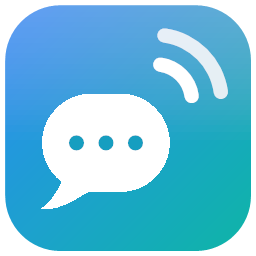
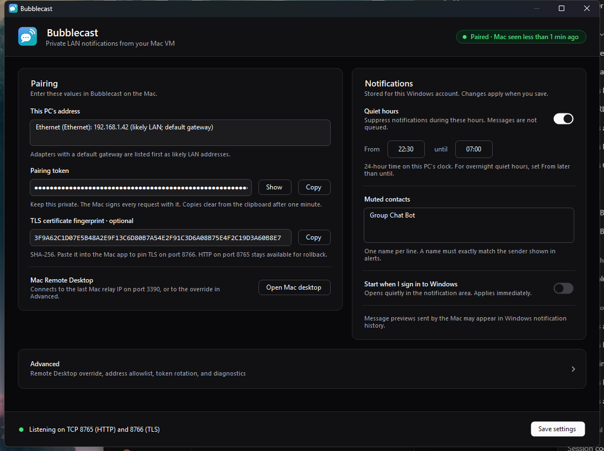
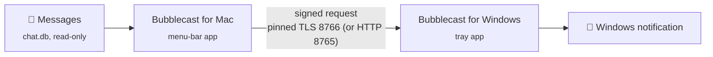
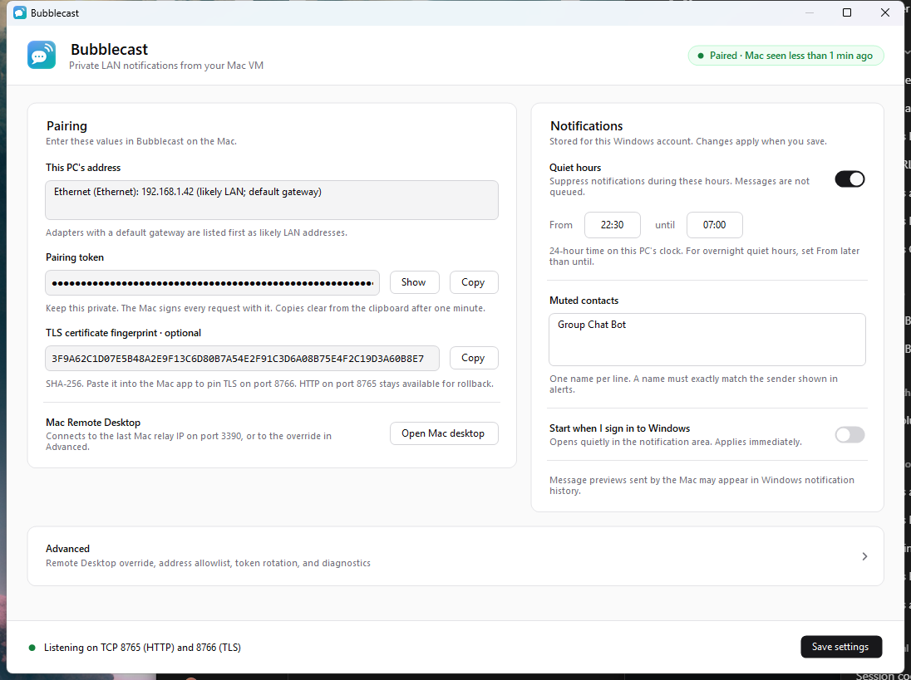
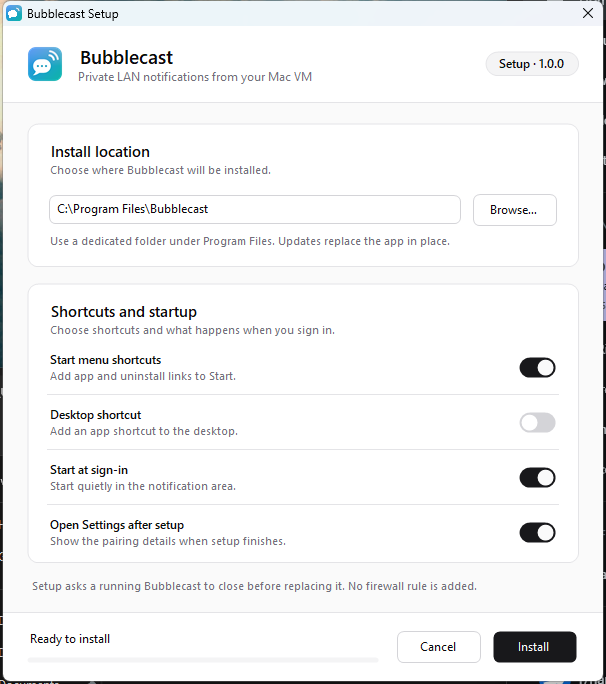
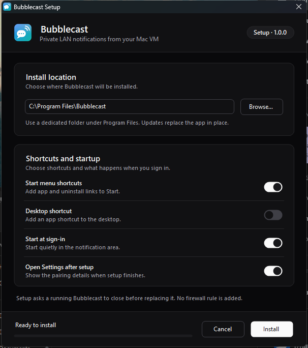

<div align="center">



# Bubblecast

**Your iMessages, on your Windows PC.**
A tiny, private relay that turns new messages on your Mac into native Windows notifications —
over your own network, with nothing in the cloud.

[](https://github.com/exelaguilar/bubblecast/releases/latest)


[](LICENSE)

[**Download for Windows and Mac**](https://github.com/exelaguilar/bubblecast/releases/latest) ·
[Mac guide](docs/MAC.md) ·
[Windows guide](docs/WINDOWS.md) ·
[How it's secured](#-private-by-design)



</div>

---

## Why Bubblecast?

iMessage lives on Apple devices. Your work lives on a Windows PC. Bubblecast bridges the two: a menu-bar app on a Mac (or a macOS VM in your home lab) watches Messages, and a tray app on Windows pops up a native notification within seconds — sender, group name, and an optional preview.

No Apple ID sharing. No cloud relay. No account. Just two small native apps talking over your LAN.

## ✨ Highlights

|  |  |
| --- | --- |
| ⚡ **Instant** | The Mac reacts the moment Messages writes a new message; bursts are batched into one tidy notification. |
| 🔒 **Private by design** | LAN only, no cloud. Every request is HMAC-SHA256 signed with replay protection, and TLS pinned to your PC's certificate is on by default. |
| 👀 **Read-only** | The Mac app only *reads* the Messages database. It never sends, replies, or modifies anything. |
| 🧠 **Smart filtering** | Skips messages you've already read, stays quiet while you're texting from your phone, skips old and iCloud-synced backlog, de-duplicates, and sends one catch-up summary after the PC was offline. |
| 🎛️ **Set it up from Windows** | The Mac's notification settings are on a **Mac** page in Windows Settings too, so you rarely need to open the Mac at all. |
| 🙋 **Real names** | Shows the sender from your Contacts, or from your own `address = name` overrides. Previews are opt-in. |
| 🔎 **Zero-typing pairing** | Windows announces itself on your network; the Mac lists it, you click **Use**, paste the token, and compare one fingerprint. |
| 🌙 **Quiet hours & mutes** | Silence notifications overnight or mute specific senders on Windows. |
| 🚨 **Knows when the Mac goes quiet** | One notice on Windows if the Mac stops checking in for five minutes, and another when it's back. |
| 🖥️ **Truly native** | SwiftUI on macOS, WinForms on Windows, light and dark themes on both — and zero third-party dependencies. |
| 🧰 **Home-lab friendly** | Built for a headless macOS VM: open-at-login, health checks, one-click Remote Desktop to the Mac, and privacy-safe diagnostics. |

## How it works



1. The Mac app watches the Messages database (read-only) and reads new incoming rows as soon as they're written.
2. It builds a small, signed request — sender, optional group name, optional preview — and sends it to your PC.
3. The Windows app verifies the signature, timestamp, and nonce, applies quiet hours and mutes, and shows the notification.

Attachments, message history, and your Apple ID never leave the Mac.

## 🚀 Quick start

**1. Windows** — Download **Bubblecast Setup** from the [latest release](https://github.com/exelaguilar/bubblecast/releases/latest) and run it. Bubblecast opens with everything the Mac needs: this PC's address, a pairing token, and an optional TLS fingerprint.

> Windows SmartScreen may warn on first run because the app isn't code-signed. Choose **More info → Run anyway**, or build it yourself from source.

**2. Mac** — Download the **Bubblecast .dmg** from the same release, open it, and drag **Bubblecast** to **Applications**. Then grant **Full Disk Access** (so it can read Messages) and, optionally, **Contacts** (for sender names).

> Bubblecast isn't signed with an Apple Developer ID, so the first launch is blocked. Open **System Settings → Privacy & Security**, scroll to the message about Bubblecast, and click **Open Anyway**. You only need to do this once per version.

**3. Pair** — In the Mac app, click **Use** next to your PC under *Found on your network* (or type its address), paste the pairing token from Windows, and click **Save**. The Mac learns your PC's TLS certificate; check that its fingerprint matches the one Bubblecast shows on Windows, click **Save** again, then **Send test**. A notification on your PC means you're done. 🎉

Full walkthroughs: [Mac guide](docs/MAC.md) · [Windows guide](docs/WINDOWS.md)

## 🎨 A look around

<table>
  <tr>
    <td width="50%"></td>
    <td width="50%"></td>
  </tr>
  <tr>
    <td align="center"><sub>Settings — light</sub></td>
    <td align="center"><sub>Settings — dark</sub></td>
  </tr>
  <tr>
    <td width="50%"></td>
    <td width="50%"></td>
  </tr>
  <tr>
    <td align="center"><sub>Setup — light</sub></td>
    <td align="center"><sub>Setup — dark</sub></td>
  </tr>
</table>

Pairing details and connection status live front and center; routine notification choices sit together; diagnostics and maintenance tuck away under **Advanced**.

## 🔐 Private by design

- **Authenticated:** every request carries an HMAC-SHA256 signature over a canonical payload, a timestamp (±120 s), and a one-time nonce. Wrong tokens, replays, and clock skew are rejected and counted.
- **Encrypted by default:** the Mac pins your PC's own certificate the first time you pair (after you compare fingerprints) and only talks to that exact certificate afterward. Plain HTTP stays available if you turn TLS off.
- **Minimal data:** sender, group name, and a preview capped at 180 characters — and previews are opt-in. No attachments, ever.
- **Secrets stay put:** the pairing token lives in the Mac Keychain and, on Windows, in your profile encrypted with Windows DPAPI. Copying it on Windows skips Clipboard History and clears itself after a minute.
- **Stays on your LAN:** nothing is sent to the internet. Setup never adds firewall rules — don't port-forward the relay ports.
- **Hardened receiver:** bounded request sizes and timeouts, a connection cap, an optional "only accept the paired Mac's IP" allowlist, and an optional single listen address.

Wire format and test vectors: [docs/PROTOCOL.md](docs/PROTOCOL.md).

## Requirements

| | |
| --- | --- |
| **Mac** | macOS 13 Ventura or later on Intel or Apple Silicon (a Mac or a macOS VM), signed in to Messages. |
| **Windows** | Windows 10 or 11 with .NET Framework 4.x (built in). |
| **Network** | Both machines on the same trusted LAN. |

## FAQ

**Can I reply from Windows?** No — Bubblecast is notifications only. Use **Open Mac desktop** to jump into the Mac over Remote Desktop.

**Does it need my Apple ID?** No. It reads what the Messages app on your Mac already receives.

**What about attachments, reactions, and group chats?** Attachments are never sent. Group chats show their name. Reaction-style rows are off by default and can be turned on.

## Building from source

```bat
:: Windows (no SDK needed: uses the C# compiler built into Windows)
cmd /c windows\build.cmd test
```

```sh
# macOS (needs the Xcode Command Line Tools)
bash macos/build.command test      # pure-logic self-checks
bash macos/build.command           # build for this Mac, install to ~/Applications, and launch
bash macos/build.command package   # universal app and dist/Bubblecast-<version>.dmg
```

Every push is built and checked on GitHub's macOS runners, and each release gets its Mac disk image from the same workflow.

## Project docs

- [Mac guide](docs/MAC.md) and [Windows guide](docs/WINDOWS.md) — install, permissions, settings, troubleshooting
- [Protocol](docs/PROTOCOL.md) — request format and cross-platform test vectors
- [Changelog](CHANGELOG.md)

## License

Bubblecast is released under the [MIT License](LICENSE).

---

<sub>Bubblecast is an independent project and is not affiliated with, endorsed by, or sponsored by Apple Inc. iMessage, Messages, and macOS are trademarks of Apple Inc. Windows is a trademark of Microsoft Corporation.</sub>
