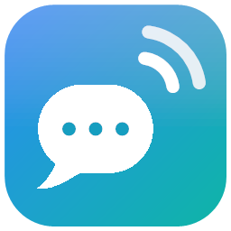

# Bubblecast for Mac



The menu-bar half of [Bubblecast](../README.md). It watches Messages (read-only) and sends a signed notification to your Windows PC within seconds.

- 🔒 Reads `chat.db` read-only; never sends or modifies messages
- 🙋 Sender names from Contacts or your own overrides; previews are opt-in
- 🧠 Skips iCloud backlog, de-duplicates, and summarizes catch-up after an outage
- 🔐 HMAC-signed requests, token in Keychain, optional pinned TLS
- 🌗 SwiftUI, light and dark, Save and Send test always in reach

```sh
bash macos/build.command        # build, install to ~/Applications, and launch
bash macos/build.command test   # pure-logic self-checks
```

Then grant **Full Disk Access** and, optionally, **Contacts**.

**→ [Full Mac guide](../docs/MAC.md)**: permissions, pairing, TLS, open at login on a headless VM, and troubleshooting.

## Layout

```text
Sources/App/    SwiftUI menu-bar app and settings view
Sources/Core/   Relay model, settings, protocol signing, Keychain, timestamp decoding
Tests/          Fake-transport self-checks and a synthetic SQLite fixture generator
Resources/      AppIcon-1024.png (generated by tools/BrandIcon.cs)
build.command   Build, sign ad hoc, install, and launch; `test` runs the self-checks
```
