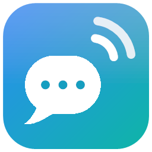

# Bubblecast for Windows



The tray half of [Bubblecast](../README.md). It receives signed notifications from your Mac and shows them as native Windows toasts.

- 🔔 Native notifications with sender, group name, and optional preview
- 🌙 Quiet hours and per-sender mutes
- 🔐 Verifies HMAC signature, timestamp, and nonce on every request; optional pinned TLS
- 🖥️ One-click Remote Desktop into the Mac
- 🌗 Light and dark themes that follow Windows, with no horizontal scrolling

**Install:** grab **Setup** from the [latest release](https://github.com/exelaguilar/bubblecast/releases/latest).

**Build** (no SDK needed; uses the C# compiler built into Windows):

```bat
cmd /c windows\build.cmd test
```

**→ [Full Windows guide](../docs/WINDOWS.md)**: Setup options, every setting, network and security notes, where data is stored, and uninstall.

## Layout

```text
src/                     Tray receiver: listener, request verification, settings UI
tests/                   Pure-logic self-checks (run by build.cmd test)
BubblecastSetup.cs       Setup and uninstaller
Bubblecast.ico           App icon (generated by tools/BrandIcon.cs)
BrandMark.png            Header mark (generated by tools/BrandIcon.cs)
build.cmd                Build; `test` runs checks; `release` writes binaries and checksums to release/
```
